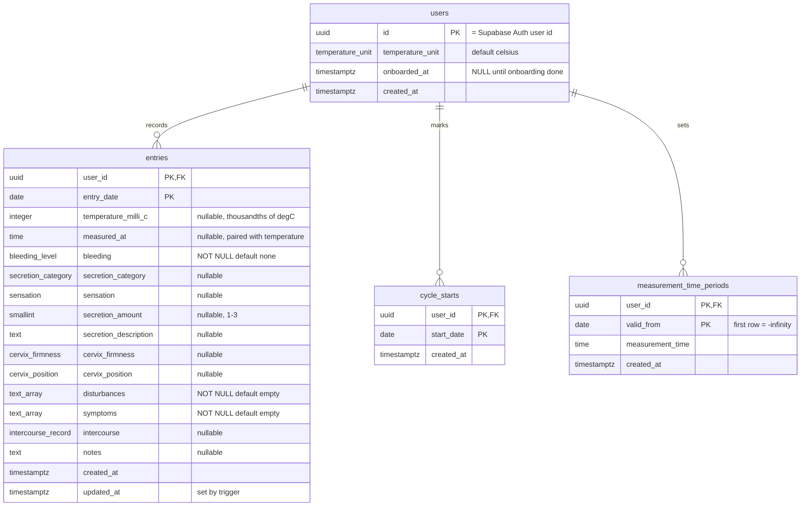

# Madam — Data Model

_Status: decided by Pe'er in step 3. Source of truth for tables, columns and
constraints. `spec-v1.md` remains the source of truth for behaviour._

_Amended at step 4 (rules and setup):_
- _**§9 is reversed.** Row Level Security **is** part of our isolation, from day one, as a second layer behind the `user_id` filter. The step-3 version of §9 said the opposite; it was written before that decision and is superseded._
- _**`updated_at` is set by a database trigger** (§4.2), not by application code._
- _**The 20–50 °C `CHECK` is kept**, and gains a twin in Go so the user never meets the database error (§4.2, §7)._
- _§10's open items are down to two, both requiring measurement rather than decision._

---

## 1. Principles

Three rules decide almost every choice below.

1. **Store facts, derive opinions.** The database holds what was measured and
   what the user declared. Cycle days, cycle lengths, adjusted temperatures,
   late/early status and every statistic are computed on read. (`project-brief.md`,
   Principle 1.)
2. **If the database can enforce it, the database enforces it.** A constraint
   survives a bug in the application; a comment does not.
3. **One representation per meaning.** No column where two different values mean
   the same thing (e.g. `NULL` and `{}` for an empty set), because that is where
   queries silently miss rows.

Four tables, no surrogate IDs, no soft deletes.

---

## 2. ERD



**What is deliberately not in the diagram:**

- **Supabase's `auth.users`.** It lives in the auth provider and holds email and
  password hash only. Our `users.id` carries the same UUID, but there is no
  foreign key between them — see §8.1.
- **Cycles.** A cycle is not a table. It is the span between one `cycle_starts`
  row and the next. See §6.2.
- **A settings table.** Settings are columns on `users`. See §8.6.
- **RLS policies and the `updated_at` trigger.** Both live in goose migrations
  alongside the tables; see §9 and §4.2.

---

## 3. Enum types

Closed sets are Postgres `ENUM` types, so an invalid value is rejected by the
database and sqlc generates a Go type with named constants — a misspelling fails
to compile instead of failing at runtime.

| Type | Values |
|---|---|
| `temperature_unit` | `celsius`, `fahrenheit` |
| `bleeding_level` | `none`, `spotting`, `bleeding` |
| `secretion_category` | `clear_stretchy`, `milky`, `sticky` |
| `sensation` | `dry`, `creamy`, `wet` |
| `cervix_firmness` | `firm`, `soft` |
| `cervix_position` | `high_open`, `low_closed` |
| `intercourse_record` | `none`, `protected`, `unprotected` |

**The two array columns are `TEXT[]` with a `CHECK`, not enum arrays.** Adding a
value to a Postgres enum is easy; removing or renaming one is not, and
`spec-v1.md` §5.1 explicitly calls the disturbance list tunable. A `CHECK`
constraint can be altered in a single migration. Symptoms follow the same
pattern for consistency between the two array columns.

Allowed values:

- `disturbances`: `alcohol`, `poor_sleep`, `illness`, `medication`, `travel`,
  `vacation`, `new_thermometer`, `uti`, `yeast_infection`
- `symptoms`: `breast_tenderness`, `bloating`, `pms`

Disturbances and symptoms stay **separate columns**. They look alike but mean
different things: a disturbance changes how the reading is drawn (hollow ring,
line skips it), a symptom is only recorded. Merging them would force the drawing
code to know which members of one set are the chart-affecting ones.

---

## 4. Tables

### 4.1 `users`

| Column | Type | Null | Notes |
|---|---|---|---|
| `id` | `UUID` | no | **PK.** The UUID issued by Supabase Auth. |
| `temperature_unit` | `temperature_unit` | no | Default `celsius`. |
| `onboarded_at` | `TIMESTAMPTZ` | yes | `NULL` until onboarding is finished. |
| `created_at` | `TIMESTAMPTZ` | no | Default `now()`. |

No email, no password, no name — identity is the auth provider's job and
duplicating the email here would only create two versions of the truth.

`onboarded_at` exists to solve one specific problem from `spec-v1.md` §8.4:
"no cycle starts because she chose *I don't know*" and "no cycle starts because
she hasn't finished onboarding" otherwise look identical.

### 4.2 `entries`

One row per user per date (`spec-v1.md` §5.3).

| Column | Type | Null | Notes |
|---|---|---|---|
| `user_id` | `UUID` | no | **PK**, FK → `users(id)` `ON DELETE CASCADE`. |
| `entry_date` | `DATE` | no | **PK.** The date the entry is *about*. |
| `temperature_milli_c` | `INTEGER` | yes | Raw measured value in **thousandths of °C**. 36.62 °C → `36620`. |
| `measured_at` | `TIME` | yes | Actual measurement time, minute precision. |
| `bleeding` | `bleeding_level` | no | Default `none`. |
| `secretion_category` | `secretion_category` | yes | |
| `sensation` | `sensation` | yes | |
| `secretion_amount` | `SMALLINT` | yes | `CHECK` between 1 and 3. |
| `secretion_description` | `TEXT` | yes | Free text (colour, texture, stretch). |
| `cervix_firmness` | `cervix_firmness` | yes | |
| `cervix_position` | `cervix_position` | yes | |
| `disturbances` | `TEXT[]` | no | Default `'{}'`. |
| `symptoms` | `TEXT[]` | no | Default `'{}'`. |
| `intercourse` | `intercourse_record` | yes | |
| `notes` | `TEXT` | yes | |
| `created_at` | `TIMESTAMPTZ` | no | Default `now()`. |
| `updated_at` | `TIMESTAMPTZ` | no | **Set by a trigger** (see below). |

Constraints beyond the column types:

```sql
PRIMARY KEY (user_id, entry_date)

-- temperature and its measurement time live or die together
CHECK ((temperature_milli_c IS NULL) = (measured_at IS NULL))

CHECK (secretion_amount BETWEEN 1 AND 3)

CHECK (disturbances <@ ARRAY['alcohol','poor_sleep','illness','medication',
       'travel','vacation','new_thermometer','uti','yeast_infection']::TEXT[])

CHECK (symptoms <@ ARRAY['breast_tenderness','bloating','pms']::TEXT[])

-- unit-bug backstop, mirrored in Go (see below)
CHECK (temperature_milli_c BETWEEN 20000 AND 50000)
```

**Why `bleeding` is `NOT NULL DEFAULT 'none'`.** It could have been nullable, with
`NULL` meaning "she didn't say." `spec-v1.md` §8.3 already chose otherwise: the
"Did bleeding stop?" prompt exists specifically to stop a *forgotten* bleeding
value from causing a false new-cycle suggestion later. That prompt only makes
sense if a skipped field saves as `none`. Accepted consequence: a day where she
logged only a temperature asserts "no bleeding," and §8.3 is the safety net.

**Why `temperature_milli_c` and `measured_at` are paired.** `spec-v1.md` §6 says
adjustment applies only to entries with a temperature, so a stored time with no
temperature is data the domain logic would have to learn to ignore. The `CHECK`
means that state cannot exist.

**The 20–50 °C `CHECK`: kept, and mirrored in Go (step 4).** It is not the §5.3
rule. §5.3's 35.00–39.00 °C bounds produce a *question*, never a rejection, and
live in Go only. The 20–50 range catches a different animal: a unit bug in our own
code. A conversion multiplying by 100 instead of 1000 would try to store `3662`,
which fails immediately instead of quietly drawing a nonsense graph for a month.

Because a database constraint violation surfaces as an ugly error rather than a
sentence a person can read, **the API applies the same bounds first** and rejects
with a clear message (`spec-v1.md` §5.3, AC-17). The `CHECK` therefore becomes a
backstop the user should never meet — it exists for the case where the bug is in
our own conversion code rather than in her typing.

**`updated_at` is set by a trigger (step 4).** A `BEFORE UPDATE` trigger on
`entries` sets it to `now()`. The alternative — writing `updated_at = now()` into
every `UPDATE` in the `.sql` files — is visible but forgettable, and forgetting it
fails silently, leaving a timestamp that quietly lies. Principle 2 applies: the
database can enforce this, so it does.

Accepted cost, and the reason it is called out in `CLAUDE.md`: **the trigger is
invisible from the code.** Nothing in Go or in any query mentions `updated_at`,
so anyone reading the codebase has to be told it exists.

Nothing in `spec-v1.md` reads `updated_at`. It is there for debugging — "was this
row written in March, or edited last week?"

### 4.3 `cycle_starts`

| Column | Type | Null | Notes |
|---|---|---|---|
| `user_id` | `UUID` | no | **PK**, FK → `users(id)` `ON DELETE CASCADE`. |
| `start_date` | `DATE` | no | **PK.** Day 1 of a cycle. |
| `created_at` | `TIMESTAMPTZ` | no | Default `now()`. |

A cycle start is **not** a flag on an entry. It stands alone, so a cycle can start
on a day with no entry at all — which is not a hypothetical: `spec-v1.md` §8.2's
"no false suggestion over a gap" rule describes exactly that day.

No `updated_at`: a start date is inserted or deleted, never edited. "Moving" a
cycle start (§8.1) is a delete plus an insert in one transaction.

**Consequence for the day-entry screen.** The "cycle starts on this day" toggle
writes to a different table than the rest of the form. Saving a day can therefore
be two writes, and they must both succeed or both fail — one transaction. Since
every request already runs inside a transaction for RLS (§9), this comes free.

### 4.4 `measurement_time_periods`

| Column | Type | Null | Notes |
|---|---|---|---|
| `user_id` | `UUID` | no | **PK**, FK → `users(id)` `ON DELETE CASCADE`. |
| `valid_from` | `DATE` | no | **PK.** First date this time applies. |
| `measurement_time` | `TIME` | no | The fixed measurement time. |
| `created_at` | `TIMESTAMPTZ` | no | Default `now()`. |

**Start dates only — there is no end date.** Each row runs until the day before
the next row's `valid_from`; the latest row runs forever. Overlapping periods are
not prevented, they are *inexpressible*, which is a stronger guarantee than a
constraint and needs no extension.

**The first row uses `valid_from = '-infinity'`** (a literal Postgres `DATE`
value). Written at onboarding, it means "this time applied since forever," so any
date she backfills from before sign-up still has a measurement time to adjust
against.

Note what `-infinity` does and does not mean: if she later changes her
measurement time, the `-infinity` row stays first and keeps covering the old
dates. That is `spec-v1.md` §7's guarantee that changing the time never rewrites
past values.

The user-facing flow asks for "the last date the previous time applied";
`valid_from` is that date **+ 1 day**. The conversion happens once, in the
handler.

---

## 5. Indexes

**None beyond the primary keys.** In Postgres a primary key creates a B-tree
index, and because ours are `(user_id, entry_date)` and `(user_id, start_date)`,
that index already serves the queries the app actually makes:

- the graph's `WHERE user_id = $1 AND entry_date BETWEEN $2 AND $3` — a range scan
  over the leading columns of the PK;
- cycle lookups by user, ordered by date;
- the one-entry-per-date rule (AC-4), which *is* the primary key rather than a
  separate unique constraint sitting next to one.

Extra indexes cost write time and space for no measurable read benefit at this
data volume (one user producing roughly 365 rows a year). If a query ever gets
slow, `EXPLAIN ANALYZE` first, index second.

RLS note: policies filter on `user_id`, which is the leading column of every
primary key here, so the policies ride on the index that already exists.

---

## 6. Derived values

Nothing in this section is stored. `docs/fam-rules.md` is the authoritative
statement of the arithmetic; this section explains why it is shaped the way it is.

### 6.1 Adjusted temperature

`spec-v1.md` §6: `adjusted = raw + 0.05 °C × (fixed − measured in minutes) / 30`,
early adds, late subtracts, displayed to 0.01 with **half-up** rounding.

The correction is not always a whole number of thousandths (a 1-minute delta is
1.667), so the intermediate value must stay exact and be rounded **once**,
directly to the displayed hundredths. Rounding twice — to thousandths, then to
hundredths — can produce a different answer.

Done entirely in integers:

```
delta      = fixed_minutes - measured_minutes      // positive = early
numerator  = 3*temperature_milli_c + 5*delta       // = exact adjusted value × 3
display_hundredths = (numerator + 15) / 30         // Go integer division
```

The `+ 15` before dividing by 30 is what makes the truncation behave as half-up.
*Caveat:* Go's integer division truncates toward zero, which equals floor only for
positive numerators. Body temperatures are always positive, so this is safe here,
and the unit test should say so out loud.

Checks against the acceptance criteria:

| Case | raw | delta | numerator | result |
|---|---|---|---|---|
| AC-1, 45 min late | 36620 | −45 | 109635 | 3655 → **36.55 °C** |
| AC-2, 30 min early | 36400 | +30 | 109350 | 3645 → **36.45 °C** |
| AC-3, 1 min late | 36500 | −1 | 109495 | 3650 → **36.50 °C** = raw, no ghost |

AC-1 resolves the question `spec-v1.md` §6 left open: 36.545 displays as **36.55**.

**Fahrenheit** is display and input only. Conversion happens from the same exact
intermediate, never from the already-rounded Celsius value, so the user never sees
a number rounded twice.

**Late/early is derived, never stored.** A reading counts as adjusted when
`display_hundredths` differs from the raw value rounded to hundredths. If they
match, there is no ghost dot and no indicator (AC-3).

### 6.2 Cycles

A cycle is a span, not a row:

- **Cycle day** of a date = that date − the most recent `start_date` on or before
  it, + 1.
- **Cycle length** = next `start_date` − this `start_date`. The current cycle has
  no length and is excluded from stats (§10 of `spec-v1.md`).
- **Cycle number** = the position of the `start_date` in the user's ordered list,
  starting at 1.
- **The unknown-start cycle** needs no storage: it is "everything from the first
  entry up to the day before the first `cycle_starts` row," and it exists only
  when `onboarded_at IS NOT NULL` and the user has no cycle start covering her
  early entries.

Because all of it is computed from `cycle_starts`, inserting or deleting one row
renumbers and recomputes everything automatically (AC-8). There is nothing to
migrate and nothing that can fall out of sync.

---

## 7. What the database enforces vs what Go enforces

| Rule | Enforced by |
|---|---|
| One entry per date (AC-4) | **Database** — primary key |
| Valid enum values | **Database** — enum types |
| Valid array members | **Database** — `CHECK` |
| Temperature and time paired | **Database** — `CHECK` |
| Secretion amount 1–3 | **Database** — `CHECK` |
| `updated_at` freshness | **Database** — `BEFORE UPDATE` trigger |
| Deleting a user deletes everything | **Database** — `ON DELETE CASCADE` |
| No overlapping time periods | **Structure** — inexpressible by design |
| Impossible temperature, 20–50 °C (AC-17) | **Go first**, with a database `CHECK` as backstop |
| Per-user isolation (AC-16) | **Go** — every query filters by `user_id` — **and the database**, via forced RLS (§9) |
| No future dates (§5.3) | **Go** |
| Unusual-temperature question, 35–39 °C (§5.3) | **Go** |
| "Did bleeding stop?" (§8.3) | **Go** (backend, per `tech-stack.md` §1.3) |
| New-cycle suggestion rules (§8.2) | **Go** |
| Measurement-time guardrails (§7) | **Go** |

**Why "no future dates" is not a `CHECK`.** `CHECK (entry_date <= CURRENT_DATE)`
is not a constraint on the data, it is a constraint on *when you write it*. A row
that was legal yesterday stays in the table, but the identical row can no longer
be inserted — which makes restoring a backup or re-running a migration behave
unpredictably. The rule is real; it just is not a database-shaped rule.

**Why the two temperature rules sit on different rows.** 35–39 °C catches a human
typo and only ever asks a question, so it cannot be a constraint at all. 20–50 °C
catches a unit bug in our own code and refuses, so it can be both — and is, with
Go providing the readable message and the `CHECK` providing the guarantee.

---

## 8. Decisions, and what was rejected

### 8.1 Identity: our own `users` table, no FK to `auth.users`

Supabase's own documentation suggests referencing `auth.users` directly. We do
not, because local development runs a plain PostgreSQL container
(`tech-stack.md` §9) which has no `auth` schema — that schema is created by
Supabase's machinery, not by our goose migrations. A foreign key to it would mean
the schema on the laptop can never match production, which is exactly the drift
goose exists to prevent. It also means swapping auth providers later touches the
middleware and nothing else.

Accepted cost: nothing at the database level guarantees that a `users.id` exists
in `auth.users`. Deleting an identity directly in the Supabase dashboard would
leave an orphan row. The account-deletion flow calls both sides, so this only
happens through manual dashboard work.

### 8.2 Temperatures as integer thousandths

Rejected: `NUMERIC(4,2)`. **Go has no decimal type** — not in the standard
library. `NUMERIC` arrives from pgx as `pgtype.Numeric` (a big integer plus an
exponent), so every piece of domain logic either wrestles with that type or pulls
in a third-party decimal library. An `INTEGER` column arrives as `int32` and the
adjustment becomes ordinary integer arithmetic, which cannot drift and is far
easier to review while still learning Go. The formula is integral in spirit
anyway: "5 hundredths per 30 minutes."

Thousandths rather than hundredths because of Fahrenheit: one step of 0.01 °F is
0.0056 °C, *finer* than 0.01 °C. Stored in hundredths, a user typing 97.91 °F
would be shown 97.92 °F back — the app silently changing a number she entered,
which contradicts the honesty principle. Thousandths make the round trip
invisible, at a cost of one extra digit.

Accepted cost: `36620` is not self-describing the way `36.62` is. The unit lives
in the column name, in this document, and in `CLAUDE.md`'s list of traps. Anyone
forgetting it is wrong by a factor of a thousand.

*To verify during the build:* the exact pgx/sqlc mapping of `INTEGER` to `int32`
and of `TIME` and `DATE` to their Go types. Expected to be straightforward, but
not yet checked against the versions we will actually install.

### 8.3 Half-up rounding

Rejected: banker's rounding (half-even). The bias it protects against is at most
0.005 °C, an order of magnitude below the ±0.05–0.1 °C accuracy of the
thermometer itself. Half-up buys something real instead: a person can check the
app's arithmetic with a pencil and get the same answer.

Worth knowing for later: if rule-based shift detection (Option C) is ever built,
a consistent half-up nudge could theoretically flip a borderline threshold day.
It is one constant in one function, covered by tests.

Also rejected: displaying three decimals. The paper chart's own grid is 0.05 °C,
so three decimals would be false precision dressed as honesty.

### 8.4 One wide `entries` table

Rejected: splitting the "show all fields" columns into a 1:1 `entry_details`
table. The instinct is that empty columns waste space, but Postgres stores NULLs
as a bit in a per-row bitmap — eight unused columns cost about a byte. The split
would add a join to every read, a second write to every save, and a permanent
"does the details row exist?" case. A 1:1 split earns its keep when one side is
huge or read in genuinely different situations; both the day popup and the day
screen want the whole row.

### 8.5 Arrays instead of junction tables

Rejected: `entry_disturbances(entry_id, tag)`. The deciding case is the graph: the
home view loads up to 90 days and needs, per day, "is there any disturbance?" for
the hollow ring. With an array that is one query returning one row per day. With a
junction table it is a second query or an `array_agg` join — generatable by sqlc,
but the simplest read path in the app becomes noticeably fiddlier to review.

A junction table would win if tags ever needed attributes of their own (severity,
a per-tag note) or if users could define custom tags. Neither is in the spec or
the future-ideas list. **If custom tags ever become a goal, this decision flips.**

Also rejected: one boolean column per tag. The spec calls the tag list tunable,
and that design makes every tweak a schema migration plus code changes everywhere.

### 8.6 Settings on `users`, not a `user_settings` table

Same fork as §8.4, same reasoning: a 1:1 table costs a join on every read and a
row-existence case forever, while adding a column later is a four-line migration.
The v1 settings screen has three items, two of which are already their own tables.

Reversible in well under an hour if settings ever grow to the point where `users`
feels cluttered.

### 8.7 Natural keys, no surrogate IDs

Because the array decision removed every junction table, **nothing in the schema
points at an entry**, which makes natural composite keys practical. The
uniqueness rule the spec needs *is* the primary key rather than a second
constraint alongside an ID, and the API addresses days by date
(`GET /entries/2026-03-15`), so there is no ID for the frontend to carry.

Rejected: UUID primary keys. UUIDs earn their keep when IDs are publicly exposed
and a neighbouring ID would leak something. Ours are scoped per user and addressed
by date, so there is nothing to enumerate, and random UUIDs are worse for index
locality for no benefit.

Accepted cost: if something ever needs to reference a *specific* entry — an
attachment, or the non-goal "multiple entries per date" becoming a goal — a
surrogate key has to be added by migration. A `BIGINT` identity column now would
have been cheap insurance against a change the spec says is not wanted.

### 8.8 Hard delete, `ON DELETE CASCADE`

No `deleted_at` anywhere. `spec-v1.md` §2 promises that account deletion
permanently wipes the user's data, and a row that is still there but hidden is not
that promise.

Accepted cost of cascade: the complete list of what gets deleted lives in the
schema, so a table added in v2 that forgets its cascade would silently survive
account deletion — the worst possible thing to get wrong on health data. The
mirror-image flaw of explicit deletes in Go is forgetting a line of code. Neither
is self-maintaining, so **"does it cascade?" goes on the checklist for every new
table** — alongside "does it have an RLS policy?" (§9).

Account deletion is two steps in one flow: delete the `users` row (cascading
everything), then call Supabase to delete the identity (`tech-stack.md` §4).

---

## 9. Row Level Security

**Decided at step 4: RLS is in from day one, as a second isolation layer.**

This section previously argued the opposite — that RLS was not our mechanism and
should not be assumed to be. That was written before the decision and is
superseded. The reasoning below replaces it.

### What it adds

AC-16 (per-user isolation) is the highest-stakes rule in the project. Today it is
guaranteed by one thing: **every query filters by `user_id`**, reviewable by
reading the `.sql` files (`tech-stack.md` §6). That is a good guarantee, and it
depends entirely on nobody ever forgetting.

RLS makes the database enforce the same rule independently. If a query omits its
`WHERE user_id = $1`, the policy returns nothing instead of returning everyone's
rows. The lock on the door, plus a lock on the safe.

### What it requires

Postgres RLS filters rows using information the *connection* carries. Our Go API
connects with a single application role, so the database cannot tell users apart
on its own — the application must tell it, per request.

1. **A per-request session variable.** Every request opens a transaction and does
   `SET LOCAL` with the authenticated user id before any query runs. The policies
   read that variable. This is the transaction wrapper in `tech-stack.md` §1.4,
   and it is the *only* path to a database connection.
2. **A non-owner application role, and `FORCE ROW LEVEL SECURITY`.** This is the
   trap worth spelling out: in PostgreSQL, superusers and roles with `BYPASSRLS`
   always bypass row security, and **table owners normally bypass it too** unless
   the table is altered with `FORCE ROW LEVEL SECURITY`. Connect as the owner
   without `FORCE` and you have RLS that is enabled, visible in the dashboard, and
   doing absolutely nothing. We do both: a role that does not own the tables, and
   `FORCE` on every table anyway.
3. **Policies with both `USING` and `WITH CHECK`.** `USING` decides which existing
   rows can be read or changed; `WITH CHECK` decides which rows may be inserted.
   Write only `USING` and a user can insert rows they could never read back.
4. **Policies live in goose migrations**, so the laptop and production are
   identical, and so a new table without a policy is visible in review.

### How it is proved

Enabling RLS and *seeing the app still work* proves nothing — that is exactly the
symptom of the owner-bypass trap. AC-16's second test therefore runs a query **as
the application role with the wrong user id set** and asserts zero rows
(`docs/fam-rules.md` §12.7, case I3). That test is the only evidence the policies
are live.

### Accepted costs

- **A new failure mode:** a request that skips the wrapper gets zero rows rather
  than an error. Loud, but confusing the first time. It is called out in
  `CLAUDE.md` as the first thing to suspect.
- **One-time setup friction on Supabase.** *Unverified:* who owns tables created by
  goose migrations there, and how easily a separate application role can be made.
  On the setup checklist.
- **It is additive, never a replacement.** Every query still filters by `user_id`.
  If the Supabase role setup proves impractical, RLS can be dropped without
  weakening anything that exists today.

---

## 10. Open items

Closed at step 4: `updated_at` (trigger, §4.2), the 20–50 °C `CHECK` (kept and
mirrored in Go, §4.2), and RLS (in, §9).

Remaining — both need measuring, not deciding:

- **pgx/sqlc type mappings** for `INTEGER`, `DATE`, `TIME` and `TEXT[]` — expected
  to be straightforward, to be confirmed at first use.
- **`-infinity` round-tripping** through pgx into Go's `time.Time` — Postgres
  accepts the literal, but Go has no infinite date. Likely handled by pgx's
  `pgtype.Date` (which carries an `InfinityModifier`); **to verify before relying
  on it.** Fallback if it is awkward: use a sentinel date such as `0001-01-01`.

Also carried to the build's verification list (`CLAUDE.md`): table ownership and
the application role on Supabase, which §9 depends on.
